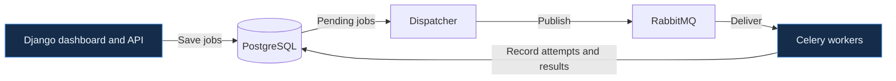

<h1 align="center">
  
</h1>

<strong>Computer Science Student</strong> · Backend Development · Distributed Systems

## Featured Project

### TaskFlow · Distributed Job Processing

**Work in progress · Local build**

TaskFlow splits a batch into independent jobs and distributes them to Celery workers. The dashboard shows which worker handled each job, how long it took, and whether it needed a retry. If a worker stops mid-job, the dispatcher can requeue the unfinished work after its execution window expires.

**Recorded demo** · The same nine jobs with simulated wait time took **18.42 s on one worker** and **6.27 s on three**. The two runs returned the same result. In a separate failure test, another worker completed a job after the original worker stopped.

`Python` · `Django REST Framework` · `PostgreSQL` · `RabbitMQ` · `Celery` · `Redis` · `Docker Compose`

## More Projects

| Project | What it demonstrates | Status |
| --- | --- | --- |
| **ResilientQ** | A Redis-backed job queue with a FastAPI service, expiring job leases, retries, and a worker failure experiment. | Local prototype |
| **Personal Life OS** | A Kazakh-language React PWA for journaling, tasks, and personal finances, backed by Django REST Framework. | Local MVP |
| **Shift Planner** | A mobile calendar prototype for a repeating day, night, and rest schedule. | Prototype |
| **Room Plant Classifier** | A Jupyter notebook comparing a custom CNN with MobileNetV2 transfer learning for image classification. | Coursework notebook |
| **Sokoban** | A C++ warehouse puzzle game with multiple levels, move tracking, and SDL2/OpenGL rendering. | [View source](https://github.com/kiikbye/-computer-grafica/blob/main/%D1%81%D1%80%D1%81%208/sokoban_gl.cpp) |
| **Computer Graphics Labs** | C++17 and OpenGL exercises covering shaders, indexed drawing, 3D transforms, and a free camera. | [View repository](https://github.com/kiikbye/-computer-grafica) |

## About Me

I'm a Computer Science student at Al-Farabi Kazakh National University. I enjoy building tools that solve practical problems and testing what happens when part of a system fails. My coursework also includes computer graphics and image classification.

## Tech Stack

**Languages** · Python, C++, JavaScript, HTML, CSS  
**Backend and data** · Django, Django REST Framework, FastAPI, PostgreSQL, Redis, RabbitMQ, Celery  
**Frontend and graphics** · React, OpenGL, SDL2, GLFW, GLM  
**Tooling** · Docker Compose, Git, CMake, Jupyter

## GitHub Activity

